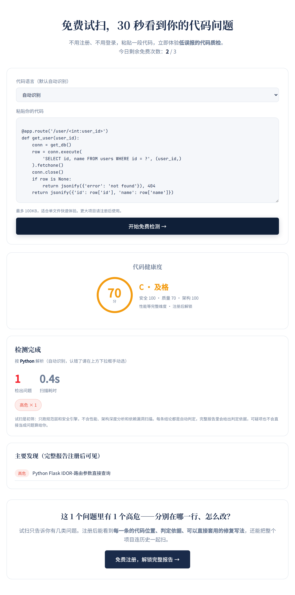
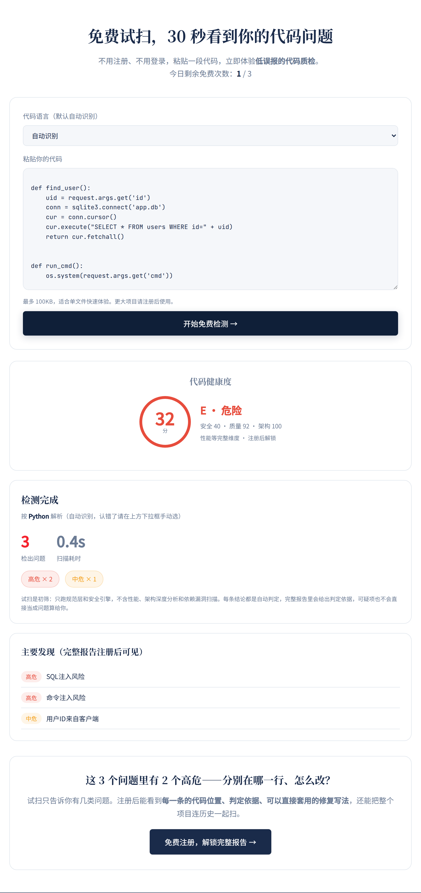

> **口径说明（2026-11-22 修订，先读这段）**
>
> 这篇文章原来写的是「拿 2740 个真实项目测」，这话不准确：那 2,740 个样本是
> OWASP Benchmark 的 Java 测试用例（1,415 个真漏洞 + 1,325 个官方标注的安全样本），
> 不是真实项目。按它的计分口径，我们检出 1,292 条、漏报 123 条、误报 0 条。
> 题库成绩要打个折看：规则照着题库补过之后，数字会好看得多，那是过拟合。
> 真实项目上我们另量了一遍自己——31.3% 的报出不成立，逐条清完是 2.9%。
> 两套数都在文里，别只挑好看的那套。
> 总体检出率我们不给百分比，只给绝对条数——百分比容易被拿去跟不同样本对比，条数不会。
> 下面按问题类型拆的百分比是同一批样本内部的分项，只用来比较哪几类难抓，不是对外成绩。

先说结论：**在 OWASP Benchmark 这 2,740 个用例上，我们检出 1,292 条、漏报 123 条、按它的计分口径误报 0 条。**

这个数字听起来不像真的。所以下面我们把样本、判据、以及没做到的部分全摊开讲。

先说个场景。AI 帮你写完一个接口，你点开看一眼：SQL 拼得整整齐齐，参数一个没少，类型转换也做了。你觉得没问题，merge 了。

但你没看的那件事是——这个接口拿 URL 里的 `id` 直接查库，没有校验当前登录的人有没有权看这个 `id`。参数写得再规范，也挡不住别人把地址栏里的数字改一下。

这就是现在大多数团队的日常：**代码的写法被看过了，逻辑没被看过。**

### 一、为什么大家不信代码扫描

因为误报。

扫出 100 条，三十条是"这里可能有风险"，二十条在测试代码里，十条报的是引用的第三方库。你点开看了三天，发现真正要修的只有两条。

第四天，这个工具就被关掉了。

这不是工具的问题，是**判定方式的问题**。绝大多数扫描器的工作方式是"看到可疑写法就报"，它不负责判断这个写法在这个上下文里到底会不会出问题。

举个最典型的：

```python
cur.execute("SELECT * FROM users WHERE id=" + uid)
```

这一行，扫描器看到"字符串拼接进了 SQL"，就报注入。

但 `uid` 是什么，决定了它是不是漏洞：

```python
# 情况 A：真漏洞
uid = request.args.get('id')          # 攻击者直接控制

# 情况 B：不是漏洞
uid = str(int(request.args.get('id')))  # 强制转成整数，注入不成立
```

两种情况在字符串层面长得几乎一样。只看这一行，谁也判不出来。

**误报就是这么来的：不是工具不够聪明，是它根本看不到 `uid` 从哪来。**

### 二、我们换了三件事

**第一件：不看字符串，看语法树**

正则表达式匹配代码，就像用关键词搜索判断一篇文章的意思。我们把 23 种语言的代码解析成语法树，先搞清楚"这是个函数调用""这是个变量赋值""这个参数流向哪里"，再谈安全。

**第二件：跨函数追数据来源**

变量从 `request` 进来，经过三层函数调用，最后进了 SQL——中间任何一层做了类型转换或者白名单校验，就不该报。

这类分析要沿着调用链一路追下去，代价是慢，但这是唯一能把"可疑"和"确定"分开的办法。

**第三件：可疑的先验证，不直接算问题**

这是最关键的一条，也是我们花了最多力气的地方。

对于不确定性高的判定，我们不直接写进"问题列表"，而是放进一个单独的"线索"区——告诉你"这里值得看一眼"，但不计入你的问题数，也不影响评分。

**只有能实际验证打穿的，才进问题列表。**

也就是说：报告里有几条，就是真的有几条要处理。不是"可能有问题"的一百条。

### 三、实测数据

我们拿 OWASP Benchmark 全量测试集做了对比测试，人工逐条复核每一条报出的问题。
它是安全领域的公开题库：每个用例是一段刻意写好或刻意写坏的小程序，标准答案由官方给出。

| 指标 | 结果 |
|---|---|
| 测试用例数（OWASP Benchmark，Java） | 2,740 |
| 官方标注真漏洞 | 1,415 条 |
| 官方标注安全样本 | 1,325 条 |
| 系统检出 | 1,292 条 |
| 漏报 | 123 条 |
| **误报**（按 Benchmark 计分口径） | **0 条** |

再拆开看检出率的分布——不同类型的问题，难度差别很大：

| 问题类型 | 检出率 |
|---|---|
| 跨站脚本（XSS） | 84.6% |
| 信任边界（Trust Boundary） | 80.7% |
| SQL 注入 | 88.6% |
| 路径穿越 | 87.2% |
| 命令注入 | 86.5% |

支撑这些判定的是 9500 多条规则，覆盖 23 种语言。

### 四、没做到的地方

上面那张表里，**漏了 123 条**。这个必须说清楚，因为它决定了你现在看到的工具是个什么水平。

漏报主要集中在两类：

一是**跨站脚本**，84.6% 的检出率是这几项里最低的。前端渲染路径太杂，模板引擎、框架的自动转义、前后端数据往返，任何一环判断错，要么漏，要么误。我们现在的策略是宁可漏也不误报——因为报错了你会关掉工具，漏了你至少还会自己看。

二是**依赖漏洞**。第三方库的 CVE 匹配是个独立问题，和代码本身的分析不是一回事，这块还在建。

所以正确的理解是：**我们擅长的是"报出来的基本都对"，不是"什么都报得出来"。**

这两件事完全不同。前者让你敢用，后者让你用得放心。我们目前做到的是前者。

**题库之外，我们量了一次自己。**

上面那套数是题库上的。题库有个坑：规则照着题库补，分数就会涨，涨到 0 条误报也不难——但那不是真实代码。

2026-11-22 我们拿自己跑出来的真实数据量了一遍：全库 9,535 条报出的问题，逐条复核后有 2,982 条（31.3%）不成立。这个数和题库上的「0 条」同时成立，不矛盾——它们量的不是一件事。

那批假问题不是散落的，高度集中在少数几条规则上：单条规则最多报过 8,025 次，把 `CollectionUtils.isEmpty(...)` 的方法名当成未定义变量；还有一条报了 1,649 次，命中的居然是 `package` 和 `import` 语句。

所以我们没去逐条修报告，而是回头审规则本身：把 1,135 条真报出过东西的规则逐条交给模型，只问一句「你对这段代码给出的结论成立吗」，判出 933 条结论本身就不成立，整条下线。清完再量，误报率 2.9%。

这里有个代价要讲明白：那次清理同时砍掉了 33.5% 本来就真成立的问题——规则错得不够干脆，一半对一半错，整条下线会把真的也丢掉。所以有几条我们没敢下，挂着等人工看。这个代价我们认，不装作没有。

### 五、两个刚扫的例子

第一段，一个写得很规范的 Flask 接口：

```python
def get_db():
    conn = sqlite3.connect('app.db')
    conn.row_factory = sqlite3.Row
    return conn


@app.route('/user/<int:user_id>')
def get_user(user_id):
    conn = get_db()
    row = conn.execute(
        'SELECT id, name FROM users WHERE id = ?', (user_id,)
    ).fetchone()
    conn.close()
    if row is None:
        return jsonify({'error': 'not found'}), 404
    return jsonify({'id': row['id'], 'name': row['name']})
```

查了参数化查询、没有字符串拼接，看上去没问题。



扫描结果：**1 条高危 —— 越权访问（IDOR）**。

为什么？路径里的 `user_id` 直接拿去查库，但代码里没有任何一句校验"当前登录的人有没有权看这个 id"。登录用户把 URL 里的 id 改成别人的，就能拿到别人的资料。

这一条不是误报。参数化查询防的是注入，防不了越权。这是两件事，很多人混在一起。

第二段，一段典型的坏代码：

```python
def find_user():
    uid = request.args.get('id')
    cur.execute("SELECT * FROM users WHERE id=" + uid)

def run_cmd():
    os.system(request.args.get('cmd'))
```



扫描结果：**2 条高危（SQL 注入、命令注入）+ 1 条中危**，健康度 32 分。

这些是真会被打穿的东西。

两段代码放在一起看，能说明一个事：**写得规范，不等于没有问题；写得糟糕，反倒一眼能看出来。** 中间那层"看着没问题、其实有隐患"的代码，才是日常最难发现的部分，也才是真正需要工具的地方。

### 六、顺带说三条挑工具的标准

如果你正在选一个代码扫描工具，不管选谁，拿这三条去问：

**一、它报出来的东西，你能修吗？**

一条"建议加强输入校验"是没有价值的。有价值的报告会告诉你：第几行、什么数据从哪进来、改哪一种写法、改完怎么验证。修不了的问题等于没报，只是给你添了一份心理负担。

**二、它敢说自己漏了什么吗？**

一个只会展示检出率的工具，可信度要打折。敢把漏报摊开讲的，说明它真的在测自己，而不是在测营销话术。

**三、拿你最没把握的那段代码去试。**

不用看 demo，不用听介绍。挑你项目里自己心里最虚的那个文件，扫一遍。它报的东西你认不认，五分钟就能判断。

### 七、你可以自己试

我们把这个能力做成了一个不用注册的入口——贴一段代码进去，几秒钟出结果。

它只跑规范层和安全引擎，不看性能、架构和依赖，所以它给的是**初筛结论，不是最终判决**。这点必须先说清楚：如果它没查出问题，不等于你的代码没问题，只等于这一层没查出问题。

入口：[xinpect.xingwangzhineng.com/try](https://xinpect.xingwangzhineng.com/try)

扫出东西来才有意义。扫出"没问题"也别急着高兴——那只是这一层没查出问题。

---

## 关于我们

煋鉴（Xinpect），代码质检工具。主打一件事：**报出来的问题，基本都是真问题。**

上面的数据来自 OWASP Benchmark 公开测试集 + 我们自己的全量扫描库，两套口径分开写、没有互相顶替。判据是逐条复核。样本和方法都在文里写了，质疑问得越细越好。
